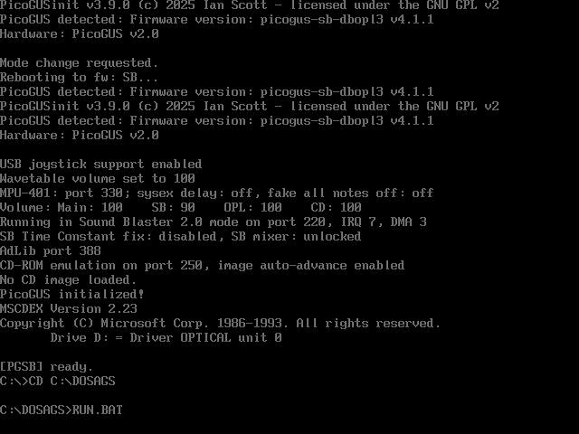
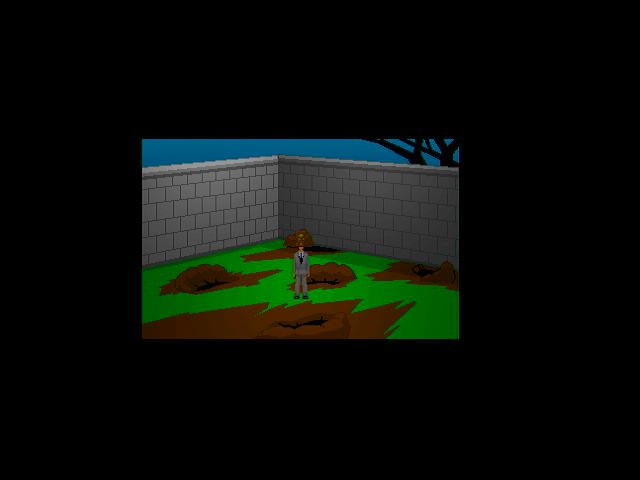
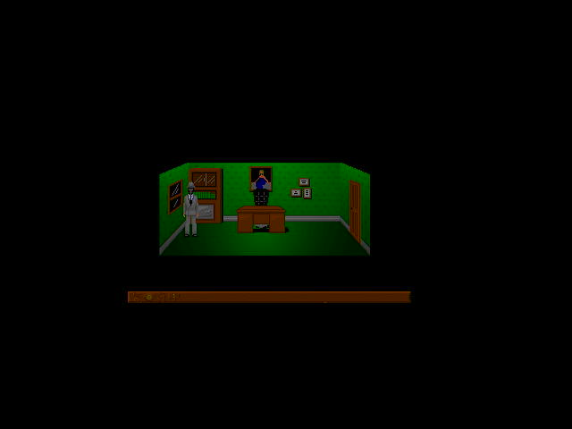

# dosags -- Adventure Game Studio games on MS-DOS

The Adventure Game Studio engine (AGS 3.6.3, engine source ported to SDL3)
running AGS games on real 486-class DOS hardware through SDL3, DJGPP and
CWSDPMI. Bring your own game: the player zip ships the engine only.

Repo: https://github.com/ecliptik/dosags -- v0.1: https://github.com/ecliptik/dosags/releases/tag/v0.1

## Screenshots

Real Gateway 2000 486DX2-66, captured from its VGA output.

| Boot | 5 Days a Stranger, 16-bit | 5 Days a Stranger, 32-bit |
|---|---|---|
|  |  |  |

5 Days a Stranger is freeware by Ben "Yahtzee" Croshaw, shown unmodified;
it is not included in the port or in this hub.

## Features

- 32-bit protected-mode DOS via DJGPP + CWSDPMI; one `AGS.EXE` for 8-,
  16- and 32-bit colour games.
- Fixed 40 Hz game timestep, direct-framebuffer VESA output.
- Sound Blaster PCM with OPL3/OPL2 FM, MPU-401 or WaveBlaster music;
  without a Sound Blaster the engine keeps MIDI music.
- A pre-decoded, threaded script VM (about 1.6x faster script execution
  on the 486) plus engine-side levers; runtime fallback to the stock
  interpreter (`DOSAGS_VM=legacy DOSAGS_ENGLEV=0`).
- Real-hardware validation through vcctrl: camera or VGA-capture witness
  on every scored run, harness-scored audio captures.

## Performance (real hardware, round N7, 2026-11-06)

486DX2-66, ATI Mach64, PicoGUS as Sound Blaster, sound on, the shipped
v0.1 `AGS.EXE` (c754df64babd). Frames displayed = 1 - frames_skipped/ticks.

| Scene | Colour | Ticks/s (steady) | Frames displayed |
|---|---|---:|---:|
| Trilby's Notes, room 35 | 8-bit | 40.23 | 99.32% |
| 5 Days a Stranger, room 3 | 16-bit | 40.13 | 99.44% |
| 5 Days a Stranger, room 3 | 32-bit, 640x480 | 40.10 | 99.52% |
| Maniac Mansion Deluxe, character select | 16-bit | 40.00 | 99.90% (x2) |

Maniac Mansion Deluxe ran at 36.5 ticks/s with about 27% of frames
displayed before the script VM and engine levers.

A second reading of each gate scene on the same exe (round V1) met the
bar at 16-bit; at 8- and 32-bit the whole-run rate (start-up included)
missed 39.2 by 0.02-0.07 because start-up ran slower that day; steady
speed and frames displayed were unchanged. The v0.1 zip itself, run as
shipped, passes (V1 DIST2: 99.42% displayed at 40.17 ticks/s).

## Known limits (v0.1)

- The Gravis UltraSound backend is not yet right on the reference machine
  (missing effects, music gaps and pitch); use OPL3 or WaveBlaster.
- AGS Quest's AutoPilot GUI scene displays 93% of frames.
- Tested on one machine (486DX2-66 + Mach64); S3 ViRGE and Cirrus cards
  are untested.
